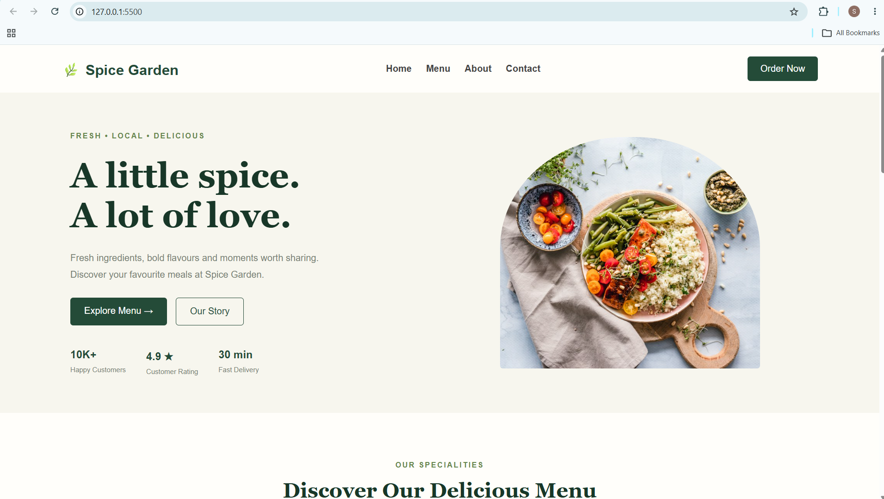
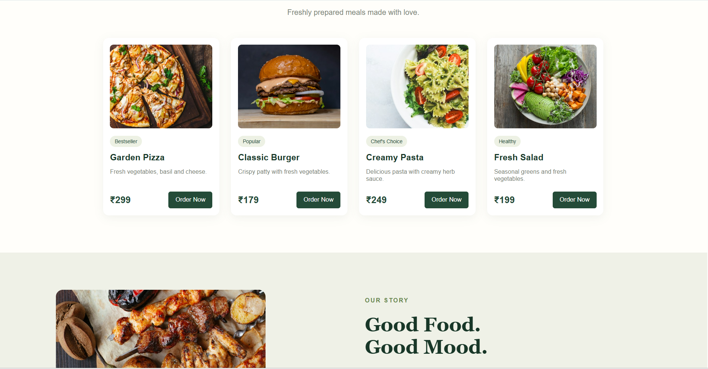
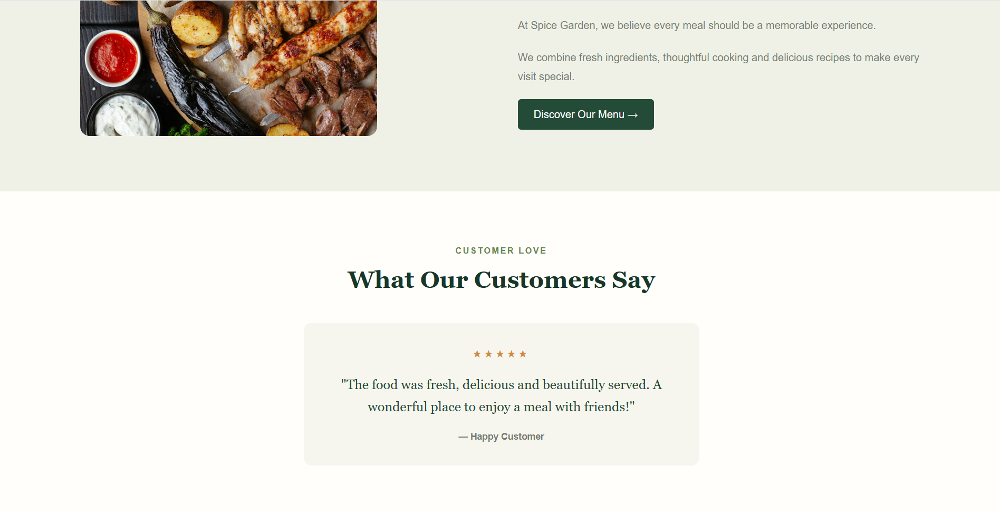
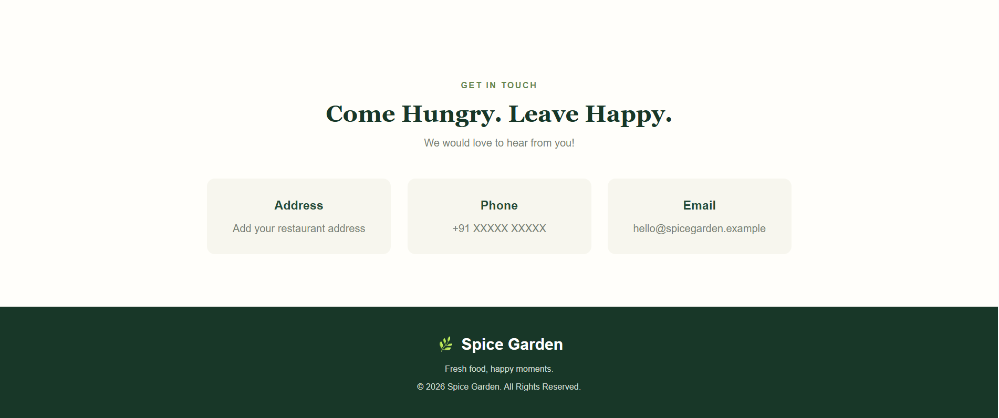

# Ex02 Commercial Website
## Date: 02-11-2026

## AIM
To create a commercial website using CSS Flexbox.

## ALGORITHM
### STEP 1
Create an HTML file (index.html)

### STEP 2
Create a CSS file (style.css)

### STEP 3
Include a navigation bar with links to different sections.

### STEP 4
Add structured sections for Homepage, Products / Services, About Us, Contact Details and User Account.

### STEP 5
Include social media links at the footer with copyright information.

### STEP 6
Define global styles for fonts, colors, and layout.

### STEP 7
Style the header, navigation bar, and sections.

### STEP 8
Use Flexbox for layout design.

### STEP 9
Add hover effects and transitions for interactivity.

### STEP 10
Add Images and Media.

### STEP 11
Use optimized images for a professional look.

### STEP 12
Open the HTML file in a browser to check layout and functionality.

### STEP 13
Fix styling issues and refine content placement.

### STEP 14
Deploy the website.

### STEP 15
Upload to GitHub Pages for free hosting.

## PROGRAM

## index.html
```html

<!DOCTYPE html>
<html lang="en">
<head>
    <meta charset="UTF-8">
    <meta name="viewport" content="width=device-width, initial-scale=1.0">
    <title>Spice Garden | Restaurant</title>
    <link rel="stylesheet" href="style.css">
</head>
<body>

    <header>
        <a href="#home" class="logo">🌿 Spice Garden</a>

        <nav>
            <a href="#home">Home</a>
            <a href="#menu">Menu</a>
            <a href="#about">About</a>
            <a href="#contact">Contact</a>
        </nav>

        <a href="#menu" class="header-btn">Order Now</a>
    </header>

    <section class="hero" id="home">
        <div class="hero-content">
            <span class="tag">FRESH • LOCAL • DELICIOUS</span>
            <h1>A little spice.<br>A lot of love.</h1>
            <p>
                Fresh ingredients, bold flavours and moments worth
                sharing. Discover your favourite meals at Spice Garden.
            </p>

            <div class="hero-buttons">
                <a href="#menu" class="primary-btn">Explore Menu →</a>
                <a href="#about" class="secondary-btn">Our Story</a>
            </div>

            <div class="stats">
                <div><h3>10K+</h3><p>Happy Customers</p></div>
                <div><h3>4.9 ★</h3><p>Customer Rating</p></div>
                <div><h3>30 min</h3><p>Fast Delivery</p></div>
            </div>
        </div>

        <div class="hero-image">
            
        </div>
    </section>

    <section class="menu-section" id="menu">
        <div class="section-heading">
            <span class="tag">OUR SPECIALITIES</span>
            <h2>Discover Our Delicious Menu</h2>
            <p>Freshly prepared meals made with love.</p>
        </div>

        <div class="food-container">
            <div class="food-card">
                
                <span class="food-tag">Bestseller</span>
                <h3>Garden Pizza</h3>
                <p>Fresh vegetables, basil and cheese.</p>
                <div class="food-bottom">
                    <h4>₹299</h4>
                    <button>Order Now</button>
                </div>
            </div>

            <div class="food-card">
                
                <span class="food-tag">Popular</span>
                <h3>Classic Burger</h3>
                <p>Crispy patty with fresh vegetables.</p>
                <div class="food-bottom">
                    <h4>₹179</h4>
                    <button>Order Now</button>
                </div>
            </div>

            <div class="food-card">
                
                <span class="food-tag">Chef's Choice</span>
                <h3>Creamy Pasta</h3>
                <p>Delicious pasta with creamy herb sauce.</p>
                <div class="food-bottom">
                    <h4>₹249</h4>
                    <button>Order Now</button>
                </div>
            </div>

            <div class="food-card">
                
                <span class="food-tag">Healthy</span>
                <h3>Fresh Salad</h3>
                <p>Seasonal greens and fresh vegetables.</p>
                <div class="food-bottom">
                    <h4>₹199</h4>
                    <button>Order Now</button>
                </div>
            </div>
        </div>
    </section>

    <section class="about-section" id="about">
        <div class="about-image">
            
        </div>

        <div class="about-content">
            <span class="tag">OUR STORY</span>
            <h2>Good Food.<br>Good Mood.</h2>
            <p>
                At Spice Garden, we believe every meal should be
                a memorable experience.
            </p>
            <p>
                We combine fresh ingredients, thoughtful cooking
                and delicious recipes to make every visit special.
            </p>
            <a href="#menu" class="primary-btn">Discover Our Menu →</a>
        </div>
    </section>

    <section class="reviews">
        <div class="section-heading">
            <span class="tag">CUSTOMER LOVE</span>
            <h2>What Our Customers Say</h2>
        </div>

        <div class="review-card">
            <div class="stars">★★★★★</div>
            <p>
                "The food was fresh, delicious and beautifully served.
                A wonderful place to enjoy a meal with friends!"
            </p>
            <h3>— Happy Customer</h3>
        </div>
    </section>

    <section class="contact-section" id="contact">
        <div class="section-heading">
            <span class="tag">GET IN TOUCH</span>
            <h2>Come Hungry. Leave Happy.</h2>
            <p>We would love to hear from you!</p>
        </div>

        <div class="contact-container">
            <div class="contact-card">
                <h3>Address</h3>
                <p>Add your restaurant address</p>
            </div>
            <div class="contact-card">
                <h3>Phone</h3>
                <p>+91 XXXXX XXXXX</p>
            </div>
            <div class="contact-card">
                <h3>Email</h3>
                <p>hello@spicegarden.example</p>
            </div>
        </div>
    </section>

    <footer>
        <h2>🌿 Spice Garden</h2>
        <p>Fresh food, happy moments.</p>
        <p>© 2026 Spice Garden. All Rights Reserved.</p>
    </footer>

</body>
</html>

```
## style.css

```css

* {
    margin: 0;
    padding: 0;
    box-sizing: border-box;
}

html {
    scroll-behavior: smooth;
    scroll-padding-top: 90px;
}

body {
    font-family: Arial, sans-serif;
    background: #fffefa;
    color: #252c25;
}

/* Header */

header {
    background: #fffefa;
    padding: 20px 7%;
    display: flex;
    justify-content: space-between;
    align-items: center;
    flex-wrap: wrap;
    gap: 20px;
}

.logo {
    font-size: 25px;
    font-weight: bold;
    color: #244b38;
    text-decoration: none;
}

nav {
    display: flex;
    gap: 25px;
    flex-wrap: wrap;
}

nav a {
    text-decoration: none;
    color: #444;
    font-weight: bold;
}

nav a:hover {
    color: #8caa69;
}

.header-btn {
    text-decoration: none;
    color: white;
    background: #244b38;
    padding: 12px 22px;
    border-radius: 5px;
}

/* Hero */

.hero {
    width: 100%;
    min-height: 550px;
    padding: 65px 8%;
    background: #f7f6ee;
    display: flex;
    align-items: center;
    justify-content: space-between;
    gap: 40px;
    flex-wrap: wrap;
}

.hero-content,
.hero-image {
    flex: 1;
    min-width: 280px;
}

.tag {
    color: #66864c;
    font-size: 13px;
    font-weight: bold;
    letter-spacing: 2px;
}

.hero h1 {
    font-family: Georgia, serif;
    font-size: 60px;
    line-height: 1.15;
    color: #183728;
    margin: 25px 0;
}

.hero-content > p {
    color: #777e73;
    line-height: 1.8;
    max-width: 450px;
    margin-bottom: 25px;
}

.hero-buttons {
    display: flex;
    gap: 15px;
    flex-wrap: wrap;
}

.primary-btn,
.secondary-btn {
    display: inline-block;
    padding: 14px 24px;
    border-radius: 5px;
    text-decoration: none;
    transition: 0.3s;
}

.primary-btn {
    background: #244b38;
    color: white;
}

.secondary-btn {
    border: 1px solid #244b38;
    color: #244b38;
}

.primary-btn:hover {
    background: #183728;
}

.secondary-btn:hover {
    background: #e8eddf;
}

.hero-image {
    display: flex;
    justify-content: center;
}

.hero-image img {
    width: 100%;
    max-width: 450px;
    height: 400px;
    object-fit: cover;
    border-radius: 48% 48% 5px 5px;
}

/* Statistics */

.stats {
    display: flex;
    gap: 35px;
    margin-top: 40px;
    flex-wrap: wrap;
}

.stats h3 {
    color: #244b38;
}

.stats p {
    font-size: 12px;
    color: #777e73;
    margin-top: 8px;
}

/* Menu */

.menu-section {
    padding: 80px 7%;
}

.section-heading {
    text-align: center;
    margin-bottom: 45px;
}

.section-heading h2 {
    font-family: Georgia, serif;
    font-size: 36px;
    color: #183728;
    margin: 15px 0;
}

.section-heading p {
    color: #777e73;
}

.food-container {
    display: flex;
    justify-content: center;
    flex-wrap: wrap;
    gap: 25px;
}

.food-card {
    background: white;
    width: 250px;
    padding: 15px;
    border-radius: 12px;
    box-shadow: 0 5px 20px #244b3812;
    transition: 0.3s;
}

.food-card:hover {
    transform: translateY(-7px);
}

.food-card img {
    width: 100%;
    height: 180px;
    object-fit: cover;
    border-radius: 8px;
}

.food-tag {
    display: inline-block;
    background: #edf1e4;
    color: #244b38;
    padding: 6px 10px;
    font-size: 11px;
    border-radius: 20px;
    margin-top: 12px;
}

.food-card h3 {
    margin: 12px 0;
    color: #183728;
}

.food-card p {
    font-size: 13px;
    color: #777e73;
    min-height: 35px;
}

.food-bottom {
    display: flex;
    justify-content: space-between;
    align-items: center;
    margin-top: 15px;
}

.food-bottom h4 {
    font-size: 20px;
    color: #244b38;
}

.food-card button {
    background: #244b38;
    color: white;
    border: none;
    padding: 10px 15px;
    border-radius: 5px;
    cursor: pointer;
}

.food-card button:hover {
    background: #183728;
}

/* About */

.about-section {
    background: #eff1e7;
    padding: 80px 8%;
    display: flex;
    align-items: center;
    justify-content: center;
    gap: 50px;
    flex-wrap: wrap;
}

.about-image,
.about-content {
    flex: 1;
    min-width: 280px;
}

.about-image img {
    width: 100%;
    max-width: 450px;
    height: 350px;
    object-fit: cover;
    border-radius: 15px;
}

.about-content h2 {
    font-family: Georgia, serif;
    font-size: 42px;
    color: #183728;
    margin: 20px 0;
}

.about-content p {
    line-height: 1.8;
    color: #777e73;
    margin-bottom: 20px;
}

/* Reviews */

.reviews {
    padding: 80px 7%;
    text-align: center;
}

.review-card {
    max-width: 600px;
    margin: auto;
    padding: 35px;
    background: #f7f6ee;
    border-radius: 12px;
}

.stars {
    color: #d18a43;
    letter-spacing: 4px;
    margin-bottom: 20px;
}

.review-card p {
    font-family: Georgia, serif;
    font-size: 20px;
    line-height: 1.7;
    color: #244b38;
    margin-bottom: 20px;
}

.review-card h3 {
    font-size: 14px;
    color: #777e73;
}

/* Contact */

.contact-section {
    padding: 80px 7%;
}

.contact-container {
    display: flex;
    justify-content: center;
    flex-wrap: wrap;
    gap: 25px;
}

.contact-card {
    background: #f7f6ee;
    padding: 30px;
    width: 280px;
    text-align: center;
    border-radius: 12px;
}

.contact-card h3 {
    color: #244b38;
    margin-bottom: 15px;
}

.contact-card p {
    color: #777e73;
}

/* Footer */

footer {
    background: #183728;
    color: white;
    text-align: center;
    padding: 40px 7%;
}

footer h2 {
    margin-bottom: 15px;
}

footer p {
    color: #d2ddd2;
    margin-top: 12px;
    font-size: 13px;
}

/* Responsive */

@media (max-width: 768px) {
    header {
        flex-direction: column;
        text-align: center;
    }

    nav {
        justify-content: center;
        gap: 15px;
    }

    .hero {
        padding: 45px 6%;
        text-align: center;
    }

    .hero h1 {
        font-size: 42px;
    }

    .hero-content > p {
        margin-left: auto;
        margin-right: auto;
    }

    .hero-buttons,
    .stats {
        justify-content: center;
    }

    .hero-image img {
        height: 300px;
    }

    .about-section {
        text-align: center;
    }

    .food-card {
        width: 100%;
        max-width: 320px;
    }
}

```
## OUTPUT





## RESULT
The program for creating commercial website using CSS Flexbox is executed successfully.